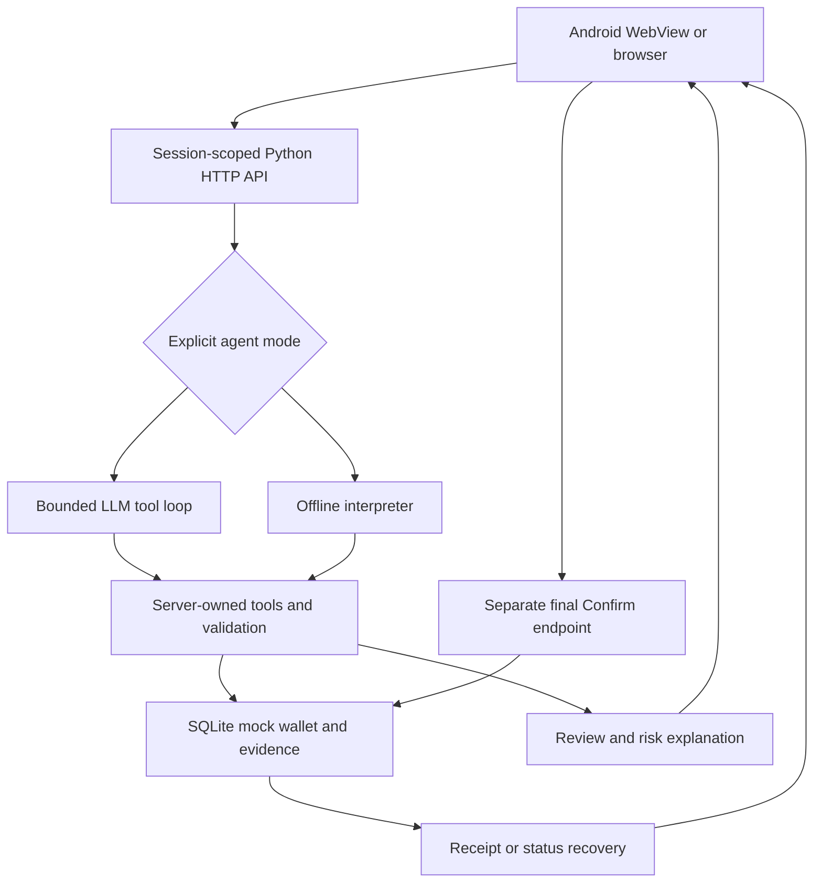

# READY: build plan for a distinctive Topic 04 MVP

Plan recorded on 21 October 2026, before this implementation increment.

## Product decision

Build a phone-first Iraqi Arabic payment companion that helps a less confident
smartphone user complete a payment, understand a risk, and recover when stuck.
The complete journey is the differentiator: ask → clarify → look up real mock
records → explain → review → explicitly confirm → verify the result → prepare
help if needed. Dynamic UI brings the relevant registered control into the chat.

The core remains Topic 04, Bill Pay & Transfer Agent. A similar public project
already demonstrates LLM tools, confirmation, retry protection and multiple
languages. Those are baseline requirements, not claims of uniqueness. We will
compete on observed usability, clear Iraqi Arabic, transparent evidence, and
reliable recovery. There is no claim that another team copied this project.

Primary user: an Iraqi wallet customer who is comfortable speaking or typing a
short request but struggles with app menus, ambiguous contact names, payment
status, and urgent payment requests. A secondary demonstration persona is a small
merchant using the same wallet. All people and financial records are fictional.

## Evidence and constraints

- Organizer Topic Briefs, dated 17 September 2026: choose one topic; use models
  for agent behavior and synthetic data; Iraqi Arabic is the default; held-out
  evaluations and three documented failure modes are required.
- Topic 04 requires explicit confirmation, questions instead of guessing,
  duplicate-payment protection and honest failure messages. Real payment
  integration is out of scope. At least 50 Iraqi dialect requests must be
  generated and edited by hand for realism.
- Build-stage brief deadline: 22 October 2026. MVP deadline: 8 November 2026,
  from the organizer's Next Steps document. Later event dates are tentative.
- Rubric: reliability 25%, technical judgment 20%, problem/impact 20%, grounding
  and responsibility 15%, evaluation 15%, clarity 5%.
- Starting repository: `6bdb9cd`, Python standard library + SQLite + static web
  client, deterministic offline router, 24 existing automated tests. A dated
  README result is not a fresh test result; rerun before extending it.
- Current prototype uses demo sessions, not production authentication. A shared
  LLM key must never be embedded in the APK or returned to the browser.

## How other topics fit inside the payment journey

| Challenge topic | Useful contribution to Topic 04 | This increment | Later gate |
| --- | --- | --- | --- |
| 01 Fraud & Scam Protection | Explain specific risk before confirmation; record the user's proceed/cancel choice | Readable rules for new recipient, unusually large debit relative to balance, and scam phrases; Iraqi coaching on the review | Tune false positives on labeled synthetic scam/legitimate cases; review with Iraqi users |
| 02 SME & Merchant Assistant | Traceable transaction context and cash remaining before a supplier payment | Exact read-only wallet summary, source transaction references, pending/failed status counts, projected balance after this payment | Three-month merchant fixture, weekly summary and explicit-assumption 30-day arithmetic projection |
| 03 AI Loan Officer | Help a user collect a complete application if lack of funds blocks their wider goal | Plan only; insufficient funds gets an honest explanation, never an invented offer | Separate opt-in fictional completeness checklist and visible rulebook; a human makes every credit decision |
| 04 Bill Pay & Transfer | Main product: Iraqi requests to reviewed, confirmed mock payments | Real bounded LLM tools alongside explicit offline mode; mobile review, receipt/status recovery, APK | Voice after typed flow is reliable; never auto-confirm from speech |
| 05 KYC Document Agent | Explain missing onboarding information or help read a synthetic bill | Plan only; do not claim identity verification or OCR | Synthetic document capture, extracted field provenance and uncertainty, user correction/human review; no real IDs |
| 06 Support Pipeline Automation | Turn a stuck payment into a useful support case | User-visible support draft with owner-scoped transaction facts and next steps; nothing sent | Human-approved issue queue, then a separate batch classifier/extractor evaluation; this helper is not the full Topic 06 pipeline |

Do not claim qualification for all six topics. Each addition must either reduce
payment mistakes, reduce taps, or improve recovery. Loans, real KYC, investment
orders, provider integrations and automatic recurring debits are outside this
increment. Existing monthly plans continue to store reminder/preparation
configuration only; no timer, notification or automatic debit is introduced.

## End-to-end architecture

The LLM may read permitted context, ask a question and request a prepared draft.
It cannot commit, confirm, change accounts, choose a session, execute code, visit
arbitrary URLs or access approval credentials. Tool arguments are checked against
a closed schema before execution. Owner identity is captured by the backend.
The backend, not generated prose, supplies amounts, recipients, status and
confirmation controls. The model's final natural-language response remains
untrusted; authoritative cards show the server's data.

### Model connection

- Keep `READY_AGENT_MODE=offline` as the explicit no-network default.
- Add `READY_AGENT_MODE=llm`, `READY_LLM_BASE_URL`, `READY_LLM_MODEL`, and
  `READY_LLM_API_KEY` in backend environment configuration only.
- Use an OpenAI-compatible Chat Completions tool interface so a documented
  Alibaba Qwen endpoint or another compatible provider can be selected without
  bundling its key in a client. Provider compatibility must be tested with the
  actual chosen model; a candidate is not a measured result.
- Reject invalid configuration early. HTTPS is required for remote providers;
  a local model may use an explicitly configured loopback HTTP endpoint.
- Bound rounds, tool calls, request size and response size; use request timeout.
  Do not retry a failed generation silently or switch to offline mode while
  presenting it as a live model result.
- Expose only a safe mode/configuration summary and a short tool activity trace.
  Never expose keys, system secrets, hidden reasoning or raw provider errors.
- Keep bounded session history, serialize concurrent turns for a session, and
  separate transcript state from server-owned active draft pointers.

### Android delivery

- A small native Java WebView app runs the existing responsive UI. The Python
  backend and LLM remain outside the APK; this is stated in setup instructions.
- Initial device route: USB debugging + `adb reverse tcp:8765 tcp:8765`, then
  `http://127.0.0.1:8765`. This keeps the existing loopback server boundary and
  avoids exposing a demo-session service to the local network.
- Optional HTTPS origin setting is a client capability for a future properly
  authenticated deployment, not a claim that the current backend is public-ready.
- Restrict navigation to the chosen origin, reject mixed content and certificate
  errors, disable unnecessary file/content access and JavaScript bridges.
- Produce a signed debug APK for sideloaded testing, record SHA-256 and build
  tool versions, and document rebuild/install/run commands. This is not a Play
  Store release or a production signing key.

## Implementation work packages and acceptance gates

1. **Baseline and plan.** Record this plan first; rerun current tests unchanged;
   create an isolated feature branch. Preserve the existing payment safety core.
2. **Real agent.** Add provider config/client and a bounded tool runner with
   deterministic test doubles. Integrate session-bound callbacks for contacts,
   bills, balance, history, status and draft preparation. Show explicit mode,
   useful progress and honest provider failures. A scripted multi-step tool run
   must reach a review without debiting or revealing an approval credential.
3. **Payment context.** Add server-generated risk reasons, balance-after-payment
   evidence and a traceable wallet summary. Risk coaching is advisory; readable
   user controls preserve cancellation and explicit final confirmation. Store
   review decisions locally without logging chat secrets.
4. **Recovery.** Add a support draft using only records visible to the current
   owner. Display reference, known status, requested issue and an actionable next
   step. Do not send a message or claim that a human received it.
5. **Mobile experience.** Keep Iraqi Arabic/RTL, large tap targets, optional large
   text, clear current task, concise review and explicit receipt/status. Add
   accessible mode/tool activity visibility, contextual suggestions and helpful
   errors. Distinguish model interpretation from authoritative wallet records.
6. **Evaluation.** Add at least 60 AI-authored synthetic development cases with
   expected route, recipient, amount, clarification and zero-debit invariant.
   Use fresh isolated data per case. Report actual misses. Label these as
   development candidates, not a hidden, independent or human-reviewed test set.
   Add meaningful unit/API tests for new security and recovery boundaries.
7. **APK and handoff.** Build actual package, verify manifest/signature/checksum,
   run browser/mobile workflow checks, publish a feature branch/draft PR and
   deliver APK with backend/API configuration instructions. Live provider quality
   and physical-device usability remain unmeasured until a key/device is used.

## Synthetic data and evaluation protocol

All fixtures use fictional names, wallet IDs, bills and payment histories. Do
not upload actual identity documents, transaction histories or customer records.
Keep a data manifest with generation method, authoring model/tool, edits and
review status. Generate more cases than needed and separate development cases
from a sealed final evaluation set before the final tuning pass.

The planned final 200 dialogues are 80 payment, 50 read/help and 70 adversarial
cases. The target is at least 90% correct on the 130 functional cases (117/130),
with zero unauthorized, incorrect or duplicate debits across all cases. Those
are targets, not current achieved results. A refusal can be correct in an
adversarial case; refusing a valid payment is still a functional failure.

Evaluate exact recipient/amount/currency, when clarification is required,
explicit-confirmation compliance, owner isolation, single debit under retries,
status recovery and unsafe effects. Record model identifier, temperature,
configuration, dataset hash, code revision, timeouts, token use where supplied,
and latency percentiles. Report denominator and failures alongside each score.

Ask Iraqi speakers to hand-edit at least 50 dialect requests and review the
coaching for realism. Conduct 5–8 consented task-based sessions with synthetic
data: ambiguous Ahmed, electricity bill, insufficient funds, suspicious request,
and uncertain-result recovery. Measure completion without assistance, mistaken
recipient/amount, number of corrections and task time. This observation must be
performed by people; automated tests cannot substitute for it. Do not invent
interviews, participant quotes, calibration or reliability statistics.

## Risks and mitigation

| Failure mode | Mitigation and test |
| --- | --- |
| Model chooses wrong Ahmed or amount | Return contact choices; require explicit information; show authoritative review; include ambiguity/amount tests |
| Injection asks model to pay or switch wallet | No confirm/session tool; owner captured server-side; strict tools and schemas; test fabricated tool names/extra fields |
| Provider timeout, rate limit or malformed output | Bounded requests, redacted error, no new payment; user may deliberately retry or use a menu |
| Review changes, expires, or user double taps | Existing owner/session/version/expiry checks and transactional idempotency; preserve regression suite |
| Scam coaching causes too many warnings | Explain exact readable rule, distinguish advisory from policy refusal, measure false positives before stronger claims |
| History/summary misleads user | Arithmetic in Python; display source references, scope and fixture limitations; never infer cash flow from three sample records |
| Support helper leaks another user's data | Owner-scoped lookup and no external send; cross-owner tests |
| API key exposed in mobile bundle/logs | Server environment only; sanitized public status; no settings field for a shared key inside APK |
| Too much scope before MVP | Prioritize complete payment + recovery; gate voice, documents, merchant projection and loan checklist on evidence |
| APK works in browser but not device | Static verification plus responsive browser checks now; physical phone/WebView and network-loss tests with user before demo |

## Week-by-week roadmap to 8 November

| Dates | Deliverables | Exit evidence |
| --- | --- | --- |
| 21–22 Oct | Five-slide compliant brief, this plan, real model adapter, first mobile APK and development evaluator | Public repo link, existing/new automated tests, APK build and honest mode display |
| 23–29 Oct | Actual API-key trial, Iraqi dialect corrections, refine multi-turn clarification and coaching, 5–8 usability sessions | At least 50 manually reviewed dialect cases; observed task results; documented provider/model and cost |
| 30 Oct–5 Nov | Freeze evaluation cases, run 200 dialogues, fix top failures using development set only; optionally voice or synthetic bill capture if core gate passes | Held-out result table with denominator, safety outcomes, latency, source hashes; three or more failure demonstrations |
| 6–8 Nov | Reproducible APK, README and progress update, short demo rehearsal, clean final evaluation | Fresh build/install check, judge-input rehearsal, one-page update and repository commit history |

## Demo story

Within the first minute, a user asks in Iraqi Arabic to pay someone called Ahmed.
The app asks which Ahmed, looks up the selected record and amount, and shows a
large review with fees and remaining balance. A specific risk reason, when
present, appears before final confirmation. A repeated confirmation returns the
same receipt. An uncertain or failed case produces a status check and a
human-readable support draft without attempting another debit. Finish by showing
real evaluation results and a judge-supplied request on the APK.

## Disclosure and delivery status

OpenAI ChatGPT and coding agents assist with planning, implementation and
synthetic case authoring. Record the deployed inference model separately when
configured. Existing synthetic fixtures and new AI-authored cases require the
stated human review before they are represented as realistic held-out evidence.
This plan is an implementation target; completed work and measured results must
be recorded separately in the README and evaluation report.
